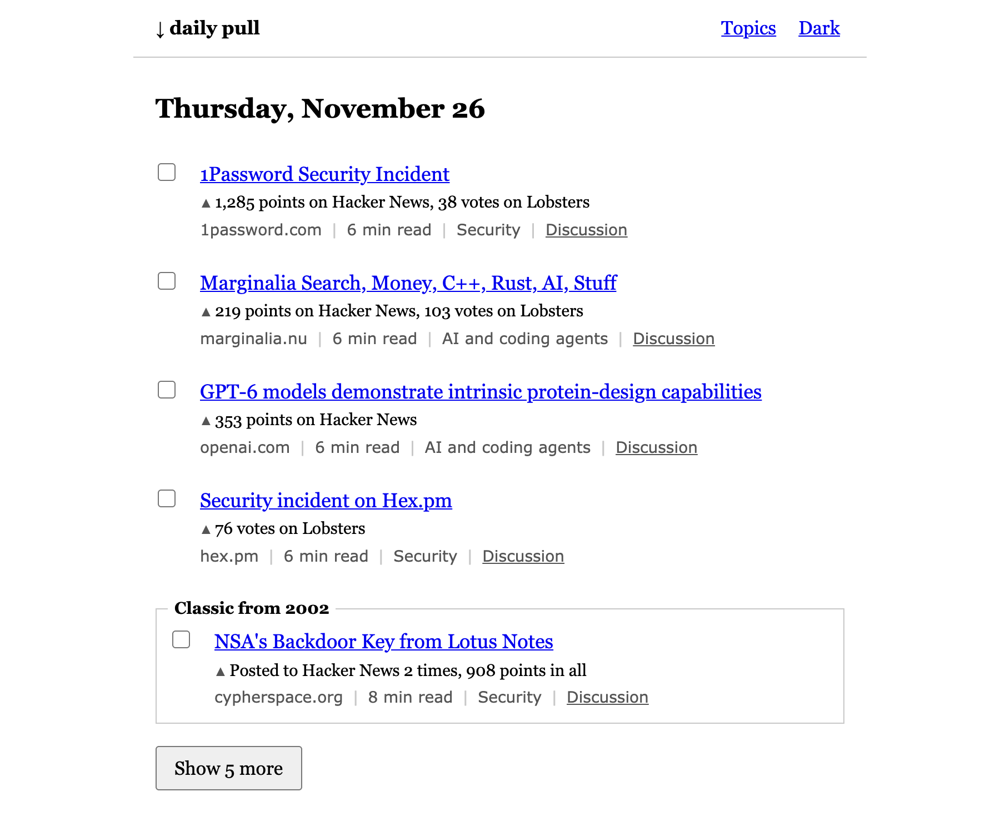

# Daily Pull

[](https://github.com/rahulshendre/dailypull/actions/workflows/ci.yml)
[](https://github.com/rahulshendre/dailypull/actions/workflows/daily.yml)
[](LICENSE)

**A few things worth reading today, for engineers. Ranked by people, not AI.**

**[rahulshendre.github.io/dailypull](https://rahulshendre.github.io/dailypull/)**

Pick your topics and how many reads you want (1, 3 or 5). Every morning the page shows the best of what engineers upvoted, what newsletter editors picked and one classic that still holds up. No account, no email, no tracking, no feed to scroll. When you are done, you are done.

<picture>
  <source media="(prefers-color-scheme: dark)" srcset="docs/screenshot-dark.png">
  
</picture>

## Contents

- [Features](#features)
- [How a link earns its place](#how-a-link-earns-its-place)
- [Architecture](#architecture)
- [Privacy](#privacy)
- [Running locally](#running-locally)
- [Configuration](#configuration)
- [Deployment](#deployment)
- [Operations](#operations)
- [Testing](#testing)
- [Project layout](#project-layout)
- [Contributing](#contributing)
- [Security](#security)
- [License](#license)

## Features

- **10 topics:** AI and coding agents, web and frontend, backend and databases, DevOps and SRE, Kubernetes and cloud native, security, Linux and systems, programming languages, open source, career and craft.
- **1, 3 or 5 reads a day.** With 3 or 5, one of them is a classic.
- **Every read says why it is there**, in plain facts: "1,285 points on Hacker News, 38 votes on Lobsters, picked by SRE Weekly".
- **Nothing repeats.** A link shown in the last 14 days is not shown again, and each classic appears only once.
- **Read state.** Tick a read off and its link turns purple. Keyboard: `j` and `k` to move, `o` to open, `x` to mark read.
- **Light and dark themes.** Dark follows the system until the reader picks one.
- **Small and fast.** Plain HTML, CSS and JavaScript: no framework, no build step, no third-party requests.

## How a link earns its place

No model decides anything. Every score comes from people.

- **Votes, compared within each site.** A story is ranked against the other stories on its own site that day, so the top of Lobsters ties with the top of Hacker News. Hacker News stories come from the last 48 hours with at least 60 points: reads that held up, not what is on top this minute.
- **Agreement.** The same link on Hacker News and Lobsters, or in two newsletters, or on an expert's blog and Hacker News, gets a bonus for every extra independent place.
- **Editors' picks.** Every link in the latest issue of hand-curated newsletters (SRE Weekly, Golang Weekly, This Week in Rust, PyCoder's Weekly, Import AI and others) counts as a vote from a human editor. Sponsor blocks and click trackers are stripped.
- **Expert blogs** (Julia Evans, Dan Luu, Brendan Gregg, Charity Majors and others) start high because they post rarely and well. Company marketing and firehoses (Medium tags, general news) start low.
- **Noise rules.** Politics, hiring threads and non-English posts are dropped. Clickbait titles and flame wars (far more comments than votes) are pushed down. Old blog posts slowly sink. Each extra pick from the same source costs a little, so no single site floods the list.

**Classics.** On Hacker News, a repost of an old article gets its year in the title, like "Choose Boring Technology (2015)". If people still upvote it years later, it held up. The build collects those (about 6,000 posts), merges reposts of the same link and offers one per topic each day.

## Architecture

```
 public sources                     once a day (GitHub Actions, 00:30 UTC)           GitHub Pages
 ──────────────                     ──────────────────────────────────────           ────────────
 Hacker News, Lobsters,             pipeline/build.py                                site/
 GitHub Trending, DEV, Mastodon     1. fetch everything (sources.py)        ──▶      index.html + app.js
 10 newsletter editors      ──▶     2. score: votes per site, agreement,             data/today.json
 70+ blogs and news feeds              noise rules (rank.py)
 Reddit (optional)                  3. pick a varied list, 6 per topic at most
 Hacker News reposts (classics)     4. one classic per topic (classics.py)
                                    5. write site/data/today.json
```

There is no server and no database. A scheduled GitHub Actions job runs the Python pipeline, which writes one JSON file of about 50 picks and 10 classics. The static page loads that file and filters it in the browser for the reader's topics. The list of links already shown is kept in the Actions cache between runs.

The pipeline fetches about 90 sources concurrently with a timeout on each. Its only dependencies are `httpx` and `feedparser`.

## Privacy

- No accounts, cookies, analytics, or third-party scripts, fonts or images.
- Topics, read state and theme live in the browser's `localStorage`. Nothing is sent anywhere.
- The page loads only its own files under a strict Content-Security-Policy (`script-src 'self'`, no inline code).
- Outbound links open with `noopener noreferrer`.

## Running locally

Requires Python 3.11 or newer.

```bash
python3 -m venv .venv && . .venv/bin/activate
pip install -r requirements-dev.txt

python -m pipeline.build                  # writes site/data/today.json (about a minute)
python -m http.server -d site 8000        # open http://localhost:8000
```

## Configuration

No API keys are needed. One optional pair of repository secrets (Settings > Secrets and variables > Actions):

| Name | What it does |
|---|---|
| `REDDIT_CLIENT_ID`, `REDDIT_CLIENT_SECRET` | Adds 16 subreddits through Reddit's official API. Create a "script" app at reddit.com/prefs/apps. Reddit blocks anonymous access. |

Sources and ranking are tuned in `pipeline/config.py`:

- `FEEDS`: blogs and news. Each entry is `(name, feed_url, [topics], prior, kind)`. `prior` (0 to 10) is where its posts start: 7 for experts who post rarely, 3 to 4 for firehoses.
- `EDITORS`: curated newsletters whose links count as editors' picks.
- `VOTE_SCALE`, `AGREEMENT_BONUS`, the penalties and the noise word lists: the whole ranking, in one place.
- `REFRESH_UTC`: when the page tells readers the next list arrives. Keep it in sync with the cron in `.github/workflows/daily.yml`.

## Deployment

The daily workflow publishes `site/` to GitHub Pages with the official Pages actions. No host tokens or secrets are involved.

1. Settings > Pages > Source: **GitHub Actions** (free plans need a public repository).
2. Actions > Daily build > **Run workflow** for the first list. After that it runs every day at 00:30 UTC.

With a custom domain, the 404 page's links are adjusted automatically at deploy time.

GitHub Pages can't send custom response headers, so the page sets its Content-Security-Policy in a meta tag. To host elsewhere, publish the same `site/` folder: `site/vercel.json` (Vercel) and `site/_headers` (Netlify, Cloudflare Pages) add the full set of security headers.

## Operations

- **One broken source never stops the run.** Every source is fetched on its own, and the build log prints the status of each one (`ok 25`, `error HTTPStatusError`, `skipped`).
- **Bad days don't ship.** If fewer than 40 candidates come back, the build exits with an error and nothing is published, so yesterday's page stays up.
- **Readers are told when a list is late.** If the new list hasn't arrived, the page says it is showing the previous day's picks.
- **History.** Links shown in the last 14 days and every classic shown in the last 10 years are kept in the Actions cache, so nothing repeats across days or redeploys.
- **Safe reruns.** Run the workflow again at any time from the Actions tab. A rerun on the same day replaces that day's list.

## Testing

```bash
python -m pytest                     # unit and browser tests
PW_CHANNEL=chrome python -m pytest   # use installed Chrome instead of a downloaded Chromium
```

The unit tests cover parsing every source, editor-link extraction (sponsors, trackers, navigation), scoring, agreement, noise rules, topic tagging, selection, classics and the build. The browser tests (Playwright) cover first-visit setup, topic filtering, the classic slot, read state across reloads, show more, changing topics, the empty, error and late states, keyboard shortcuts, blocked storage, unsafe links, themes and the mobile layout. CI runs both on every push and pull request.

## Project layout

```
pipeline/
  config.py      sources, topics and every ranking constant
  sources.py     fetchers and parsers for each source, editor-link extraction
  rank.py        filtering, topic tagging, scoring and selection
  classics.py    Hacker News year-tagged reposts
  build.py       runs the pipeline and writes site/data/today.json
site/
  index.html     the page
  assets/        app.js, theme.js, style.css, favicon
  404.html, robots.txt, vercel.json, _headers
tests/           unit tests, Playwright browser tests, fixtures
.github/workflows/
  ci.yml         tests on every push and pull request
  daily.yml      daily build and deploy
```

## Contributing

The most useful contribution is a source: a blog, newsletter or community that keeps publishing things engineers should read. See [CONTRIBUTING.md](CONTRIBUTING.md).

## Security

Please report vulnerabilities privately. See [SECURITY.md](SECURITY.md).

## License

[MIT](LICENSE)
